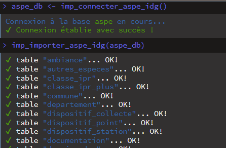

# 1b. Importation des tables de la base ASPE depuis l'IDG (OFB)

## Objectif

Récemment (*depuis octobre 2025*), la base ASPE est présente dans l’IDG
de l’OFB (= **I**nfrastructure de **D**onnées **G**éographiques).

Il est donc maintenant possible d’importer directement les tables de la
base ASPE depuis l’IDG (*sans passer par la conversion d’un dump ASPE* ;
cf. [vignette importation
tables](https://pascalirz.github.io/aspe/articles/aspe_01_importation_tables.html)
).

A noter que cet accès via l’IDG :

- est restreint aux agents de l’OFB, ayant préalablement été inscrits
  comme utilisateurs ;
- se fait à partir du réseau interne de l’OFB (ou via le VPN à
  l’externe) ;
- nécessite de disposer des paramètres de connexion à la base IDG
  (adresse, login, …).

Les tables importées sont sous la forme de `dataframes`, et sont
directement utilisables depuis l’IDE utilisé (comme `RStudio`), et sont
compatibles avec les autres fonctions du package
[aspe](https://github.com/PascalIrz/aspe/).

### Installer et charger le package `{aspe}`

Charger le package [aspe](https://github.com/PascalIrz/aspe/),
téléchargeable depuis GitHub :

``` r

install.packages("devtools")
devtools::install_github("pascalirz/aspe")
```

Eventuellement cette commande vous retournera un message demandant de
mettre à jour des `packages`. Acceptez au moins les mises à jour depuis
le [CRAN](https://cran.r-project.org/).

… et des autres qui sont nécessaires pour exécuter les scripts.

``` r

# chargement packages
library(aspe)
library(dplyr)
library(usethis)
```

### Stocker les informations de connexion dans son R environnement

Pour des raisons de sécurité (*et de bonnes pratiques*), il convient de
ne pas exposer les informations sensibles de connexion à tous. C’est
pourquoi, il est conseillé de stocker ces informations dans
l’environnement `R` (fichier `.Renviron`) sur son ordinateur. La
fonction de connexion à la base aspe via l’IDG utilise ces informations
(càd. *nommées ainsi*).

Pour stocker les informations dans votre environnement `R`, vous pouvez
procéder comme ceci :

``` r

## 1° - ouvrir le fichier de configuration de l'environnement R avec la fonction du package usethis (installer le package si nécessaire).
usethis::edit_r_environ()

## 2° - dans la fenêtre ouverte intitulée '.Renviron', 
# sauvegarder les lignes suivantes avec le bon paramétrage
BDD_IDG_HOST = "URL_DE_LA_BDD"
BDD_IDG_LOGIN = "IDENTIFIANT_POUR_CONNEXION_A_LA_BDD"
BDD_IDG_PWD = "MDP_POUR_CONNEXION_A_LA_BDD"
BDD_IDG_PORT = "LE_PORT_DE_LA_BDD"
BDD_IDG_ASPE_NAME = 'NOM_DE_LA_BDD'
```

Sauvegarder le fichier `.Renviron` et redémarrer votre session `R` pour
que les informations renseignées soient utilisables.

Au redémarrage, vérifier les informations stockées en tapant ces lignes
suivantes :

``` r

## 3° - ces informations doivent être visibles dans la console R :
Sys.getenv('BDD_IDG_HOST')
Sys.getenv('BDD_IDG_LOGIN')
Sys.getenv('BDD_IDG_PWD')
Sys.getenv('BDD_IDG_PORT')
Sys.getenv('BDD_IDG_ASPE_NAME')
```

### Importation de la base depuis l’IDG

Après ces réglages, vous êtes prêts à utiliser les fonctions
d’importation aspe liées à l’IDG 🤩.

En pratique, il faut d’abord (i) se connecter à la base de l’IDG, puis
(ii) lancer l’importation.

Deux fonctions facilitent le processus :

``` r

# connexion à l'IDG
# ! veillez à disposer des informations de connexion et un droit d'accès
aspe_db <- imp_connecter_aspe_idg()

# importation des tables de la base aspe
imp_importer_aspe_idg(aspe_db)
```

Chaque table est importée une par une. L’opération est assez rapide
selon l’état de votre connexion (*de l’ordre de 3 à 5 min* 🚀).



> A noter qu’il est possible de choisir d’inclure ou d’exclure certaines
> tables lors de l’importation, en utilisant les arguments `tab_select`
> et `tab_excl` dans la fonction
> [`imp_importer_aspe_idg()`](https://pascalirz.github.io/aspe/reference/imp_importer_aspe_idg.md).
> Par exemple, si l’on souhaite importer uniquement la table des
> opérations, il suffit d’écrire:
> `imp_importer_aspe_idg(aspe_db, tab_select = "operation")`

Quand l’importation est terminée, une centaine de tables au format
`dataframe` apparaissent dans l’onglet “Environnement” de RStudio.

Pour éviter d’avoir à répéter cet import, on peut en sauvegarder le
résultat au format `.RData` de façon à accéder plus rapidement aux
données par la suite. La fonction
[`export_tables_rdata()`](https://pascalirz.github.io/aspe/reference/export_tables_rdata.md)
peut être utilisée pour cela.

Elle nomme les fichiers (`tables_sauf_mei` et `mesure_individuelle`) en
fonction des dates et heures systèmes (pour éviter d’écraser
malencontreusement d’anciens fichiers) et les sauvegarde par défaut dans
un sous-répertoire `/processed_data` du répertoire de travail. Si
celui-ci n’est pas pré-existant, il est créé.

> NB: Il est possible de scinder les tables `mesure_individuelle` en
> plusieurs parties afin de faciliter le dépôt sur des espaces de
> stockage (avec taille limité). Par exemple, pour créer 2 parties, la
> fonction s’utilise comme ceci:
> `export_tables_rdata(n_fichiers_mei = 2)`.

``` r

export_tables_rdata()
```
